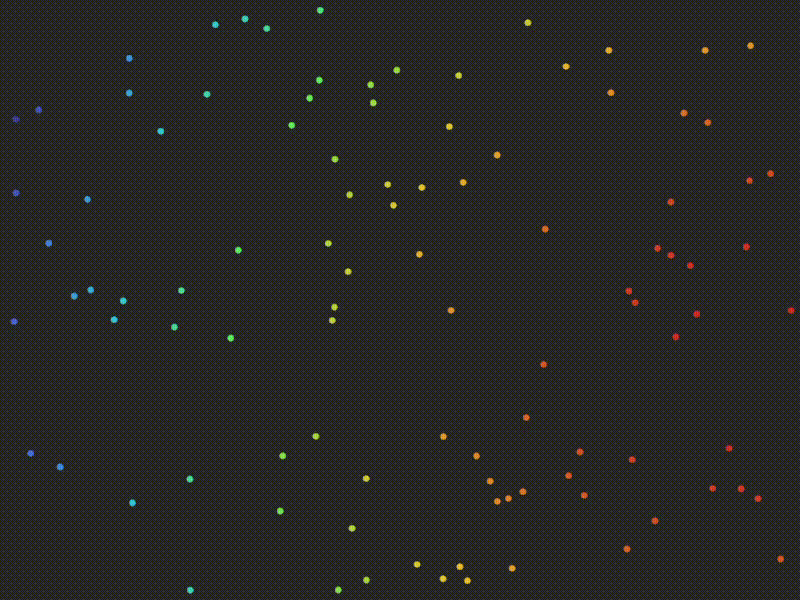

# Algoritmos Genéticos — Visualizador Interativo

Visualizador em tempo real de um Algoritmo Genético. Cada indivíduo é um ponto no plano 2D; o objetivo é convergir para o alvo (segue o mouse). Suporta **evolução assexuada** e **sexuada** (crossover + mutação), com registro de estatísticas por geração em CSV.

---

## 📦 Arquitetura

| Módulo | Responsabilidade |
|--------|------------------|
| `main.rs` | Bootstrap do `eframe` e parsing de argumentos |
| `cli.rs` | Argumentos via `clap` (`Args`, `EvolutionMode`) |
| `ga.rs` | `Individual`, `Population`, `FitnessContext` e operadores genéticos |
| `app.rs` | Loop de renderização, input e orquestração da evolução |
| `stats.rs` | Struct `GenerationStats` e escrita incremental em CSV |

---

## 🚀 Uso

```bash
cargo run --release -- [OPÇÕES]
```

Pressione **`A`** na janela para avançar uma geração. Mova o mouse para reposicionar o alvo.

### Argumentos

| Flag | Default | Descrição |
|------|---------|-----------|
| `--width <u32>` | `800` | Largura da janela |
| `--height <u32>` | `600` | Altura da janela |
| `--population <usize>` | `100` | Tamanho da população |
| `--mutation <f32>` | `20.0` | Intensidade de mutação por gene |
| `--evolution <asexual\|sexual>` | `asexual` | Modo de evolução |
| `--parent-pool <usize>` | `3` | Nº de pais no pool (só modo sexuado) |

### Exemplos

```bash
# Evolução assexuada (padrão)
cargo run --release

# Evolução sexuada com pool de 10 pais
cargo run --release -- --evolution sexual --parent-pool 10 --population 200
```

---

## 🧬 Modelo Evolutivo

### Indivíduo
- Genes: `(x, y)` no espaço `[0, width] × [0, height]`
- **Fitness**: `1 − (dist² / max_dist²)`, normalizado em `[0, 1]`
- **Mutação**: deslocamento uniforme em `[−s, s]` por gene, com `s = |mutation|`

### Operadores

**Assexuada** — o melhor indivíduo é clonado e sofre mutação para toda a próxima geração.  
**Sexuada** — os *N* melhores (`parent_pool`) formam o pool reprodutor; cada filho é gerado via **crossover aritmético** (peso aleatório por gene) entre dois pais distintos, seguido de mutação.

### Detalhes de performance

- **Zero alocação em regime**: `evolve_sexual` reutiliza dois `Vec` persistentes (`scratch_ranked`, `scratch_next`) com `std::mem::swap`.
- **Top-K em O(N)**: `select_nth_unstable_by` evita ordenar toda a população.
- **Fitness recíproco pré-computado** (`inv_max_dist_sq`): troca divisão por multiplicação no hot path.
- **`max_dist_sq` recalculado apenas quando o alvo se move** — sem custo por frame parado.

---

## 📊 Saída: `evolution.csv`

Arquivo criado/limpo na inicialização e **anexado** a cada geração.

```csv
geracao,media_fitness,desvio_padrao_fitness,mutacao,parent_pool
0,0.4523,0.1874,20.0000,3
1,0.5310,0.1643,20.0000,3
2,0.6187,0.1401,12.0000,3
```

- `mutacao`: valor absoluto efetivamente aplicado.
- `parent_pool`: **valor efetivo após `clamp(2, N)`**; vazio no modo assexuado.

Pronto para consumo direto em `pandas` / `Excel` / `R`.

---

## 🖼️ Resultados


